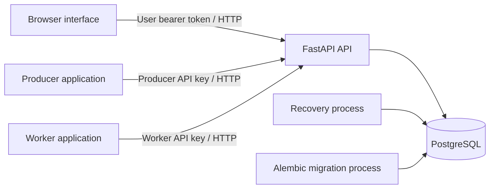

# Architecture

This page describes the implemented system and recommends small application structures for independent workers and producers. Recommendations do not imply that every example implements crash recovery, automatic HTTP retries, or graceful draining. Public contracts are in the [API reference](api.md); installation and process commands are in the [development guide](development.md).

## System components

Orqbit is a modular FastAPI application backed by PostgreSQL, with a React/TypeScript interface and independent producer and worker applications. PostgreSQL stores the queue and execution history; no separate message broker is required.



| Component | Responsibility and boundary |
| --- | --- |
| API (`backend/src`) | Authenticates callers, checks access, stores submissions, atomically claims jobs, renews leases, and accepts outcomes. It does not execute job handlers. |
| PostgreSQL | Source of truth for users, producer/worker registrations, permissions, jobs, submission keys, and execution attempts. Parameters, results, and errors are JSONB objects. |
| Recovery (`backend/src/recovery.py`) | Separate long-running process using the backend's configuration and database code. Closes expired attempts and schedules bounded retries or fails exhausted jobs. |
| Alembic (`backend/migrations`) | Applies schema changes explicitly. Importing or starting the API does not create tables. |
| Frontend (`frontend/`) | Uses user authentication to submit and inspect jobs and manage registrations. It does not execute or claim work. Vite proxies `/api` locally; the Compose Nginx container serves the built frontend and proxies API requests. |
| Producers (`examples/producers/`) | Turn application input into job submissions and optionally track results through the public HTTP API. |
| Workers (`examples/workers/`) | Pull eligible work, execute it locally, and report an attempt's outcome through the public HTTP API. |

Compose provides database, migration, API, recovery, and frontend services. Producers and workers are started separately; each has its own dependencies, environment, configuration, and tests. They must not import backend or sibling-application code or access Orqbit's database.

## Backend organization and transactions

The current backend uses synchronous SQLAlchemy sessions and ordinary synchronous route handlers:

- `api/routers/` handles HTTP input, authentication dependencies, responses, and route-specific error translation. List/read routes also build SQLAlchemy queries directly.
- `dto/` defines Pydantic request and response contracts, separately from ORM entities in `models/`.
- `services/` implements submission, permissions, registration management, and job lifecycle operations. These functions also perform persistence; there is no separate repository layer.
- `database.py` owns engines, session creation, connection checks, and application query/lock timeouts. `main.py` maps unhandled database errors to safe HTTP responses.

Mutating service functions commit their changes explicitly; read operations do not commit. The request-scoped session closes after the request, rolling back uncommitted work. Recovery uses a new session per scan and commits a bounded batch. Transactions cover coordination only and never remain open while a worker executes its task.

Application defaults bound SQL statements to 5000 ms and lock waits to 1000 ms. Temporary storage failures return 503, other unhandled driver failures return 500, and invalid database values return 422. An interrupted commit can leave its outcome uncertain to the caller; the API does not automatically replay operations. See [database timeouts and retries](api.md#database-timeouts-and-retries).

## Identities, ownership, and access

A user account owns producer and worker registrations. Users authenticate with bearer tokens; producer and worker applications use their own `X-API-Key` credentials. API keys are returned at creation or reissue and stored only as SHA-256 hashes. Owners can reissue either kind of key; producers can also be deactivated. Deletion is limited to unreferenced registrations so jobs and execution history are preserved.

User job reads apply ownership and job-sharing policies. A worker can claim matching types according to its owner's job permissions or explicit worker grants. Worker metadata visibility is a separate policy and does not grant permission to execute another user's private jobs.

A producer submits on behalf of its owner, saving both `user_id` and `producer_id`. Its API key can read only jobs submitted by that producer, including when another job belongs to the same user or is public. The owner's user token can read those jobs through the regular user routes. Producer API keys do not provide an attempt-history endpoint or registration-management access.

Registered worker identity is not process-instance identity: two processes sharing a key authenticate as the same worker. Attempt ownership and generation checks prevent stale reports, but there are no per-attempt tokens or superseded-process fencing.

## Job and attempt lifecycle

A job represents the client's request; an attempt represents one execution assigned to a worker. The job keeps its identity across retries, while each execution receives a new attempt ID and number.

```text
Job:      PENDING -> RUNNING -> SUCCEEDED
                         |  -> FAILED       (reported failure or exhausted budget)
                         +---> PENDING      (lost attempt, remaining budget, delayed retry)

Attempt:  RUNNING -> SUCCEEDED | FAILED | LOST
```

1. A user sends `POST /jobs/`, or a producer sends `POST /producer/jobs`, with a JSON-object payload and required `Idempotency-Key`. Matching replays return the existing job in its current state. Keys are unique per owning user, shared across that user's producers and direct submissions; another submitter cannot reuse a reserved key, even with matching content.
2. A worker sends bodyless `POST /workers/claim`. Stored capabilities, access rules, `PENDING` status, `available_at`, and attempt budget determine eligibility. PostgreSQL `FOR UPDATE SKIP LOCKED` selects the oldest eligible job by ID. Under that lock, claim increments `attempts_count`, inserts the leased attempt, and marks the job `RUNNING`, committing all changes together. The current empty response is 404 with `No jobs were found`.
3. The worker executes outside the backend transaction. For longer tasks, it renews the owned attempt with `POST /workers/{attempt_id}/heartbeat`. The server checks PostgreSQL time after acquiring the attempt lock. Renewal uses `max(existing_deadline, database_now + LEASE_EXTENSION_SECONDS)`; it cannot revive an expired lease.
4. The worker reports to `/workers/{attempt_id}/succeed` or `/fail`. A first outcome requires ownership, the current running attempt, and an unexpired lease. Job and attempt are updated together. An identical replay of an accepted outcome is safe, including after its deadline; contradictory reports return 409. Worker-reported failures are terminal.
5. Recovery marks expired running attempts `LOST`. With remaining budget, it returns the job to `PENDING` and persists a delay of 10, 20, 40, then at most 60 seconds. Otherwise the job becomes `FAILED`. `MAX_ATTEMPTS` is saved per new job, includes the first execution, and defaults to 1, disabling retries. Recovery schedules work; a later claim creates the next attempt.

The database additionally enforces unique `(job_id, attempt_number)` pairs and at most one `RUNNING` attempt per job through a partial unique index. These constraints and row locks protect persisted coordination. They cannot stop an old worker's external effects after lease expiry, so retried handlers need a stable job or business-operation key to deduplicate such effects. Exactly-once execution is not guaranteed.

Liveness checks only show that the API responds. Readiness verifies database access, migration heads, and mapped tables/columns, but does not audit indexes/constraints or recovery liveness. Without recovery, expired reports are rejected while stored jobs can remain `RUNNING`. Attempt heartbeats are not worker-process online status; successful renewal currently has no hard execution deadline.

## Recommended worker architecture

Start with a synchronous loop that claims and completes one attempt at a time. This is the structure used by the runnable examples and makes ownership and error handling easy to follow. Register only types implemented by that application, and use a separate registration/key for independently managed workers.

```text
my_worker/
  pyproject.toml, uv.lock    Own dependencies and reproducible environment
  .env.example              API URL, worker key placeholder, and timing settings
  settings.py               Validated configuration loaded beside the application
  api.py                    Claim, heartbeat, and outcome HTTP requests
  worker.py                 Startup, polling loop, and process-level errors
  execution.py              Optional coordination of one attempt
  task.py                   Task validation and business logic, when substantial
  heartbeat.py              Only for work needing lease renewal
  tests/                    Local task, HTTP, configuration, and lifecycle tests
```

These are responsibilities, not mandatory layers. The short [`add_numbers`](../examples/workers/add_numbers/README.md) worker keeps its task and attempt handling in `worker.py`. [`csv_summary`](../examples/workers/csv_summary/README.md) separates a larger pure task from execution/reporting. The [`worker_foundation`](../examples/workers/worker_foundation/README.md) directory is an incomplete template for the [heartbeat tutorial](../tutorials/worker-leases-and-heartbeats/README.md), not a runnable worker or shared runtime package.

Keep `api.py` concerned with transport: bounded request timeouts, `X-API-Key`, JSON, and the exact empty-queue response. Only the claim route's 404 with `No jobs were found` means an empty queue; authentication errors, missing attempts, and storage failures must not become empty polls. Keep domain input validation and computation in the worker, because Orqbit validates generic JSON contracts rather than job-type-specific schemas.

| Workload | Recommended execution model | Existing reference |
| --- | --- | --- |
| Short bounded task | Execute directly and report within the initial lease, allowing time for the HTTP request. No heartbeat machinery is needed. | `add_numbers`, `csv_summary` |
| Waiting or incremental I/O | Split work into bounded steps, check the lease, and renew between steps. Give each I/O operation a timeout that leaves time for renewal/reporting. | `delay_with_heartbeat` demonstrates cooperative waiting |
| CPU work that can yield | Process bounded batches and check/renew between batches. Keep each batch short enough to leave lease headroom. | `count_primes` |
| Long blocking work that cannot yield | If required, supervise a child process while the parent owns renewal and reporting. Define how lease loss stops that process before adopting this extra machinery. | Recommendation only; not implemented in the examples |

For lease-aware execution, read the returned `lease_expires_at`, leave margin for network and scheduling delays, and use each renewal's returned deadline. Keep host clocks synchronized; the server's database clock decides acceptance. An expired deadline, rejected renewal, or uncertain ownership should stop execution cooperatively without sending a replacement failure report. A lease cannot undo effects already performed.

Separate task errors from transport errors. Invalid task input can produce a structured `/fail` error; a lost success response must not trigger a contradictory failure. If adding outcome retries, resend only the identical payload for the same attempt. A repeated claim can acquire different work after a lost response; it does not resume an abandoned attempt. Existing worker examples stop on HTTP/connection errors and do not retry automatically.

Poll with a pause when no job is available; the examples use a fixed configurable interval. Add bounded backoff/jitter only when implementing a deliberate network-retry policy. Do not preclaim work beyond execution capacity. Parallel execution, persistent local recovery, and graceful draining require their own ownership and shutdown rules and are not provided by the examples.

Test task validation independently, mock HTTP at the application boundary, and test empty claims, outcome failures, and lease loss with controlled clocks. Keep each application's tests in its own directory; PostgreSQL concurrency belongs to backend integration tests.

## Recommended producer architecture

A producer translates a business request into a stable job type, parameters, access policy, and submission key. It submits work and observes status/result; execution belongs to a worker. The browser is also a submission client, using user bearer routes. Unattended producer applications should use their registered producer key and `/producer/jobs` routes rather than handling interactive user passwords or worker credentials.

```text
my_producer/
  pyproject.toml, uv.lock    Own dependencies and reproducible environment
  .env.example              API URL, producer key placeholder, timing settings
  settings.py               Validated configuration
  api.py                    Submission and job-read HTTP requests
  producer.py               Input, validation, keys, submission, optional polling
  tests/                    Input, HTTP, idempotency, polling, and shutdown tests
```

Start with one entry point and a thin HTTP module, as in [`add_numbers_cli`](../examples/producers/add_numbers_cli/README.md). Add a separate domain module only when constructing/validating requests becomes substantial. Producers remain independently installable and communicate with Orqbit only over HTTP.

| Use case | Recommended flow | Existing behavior and limits |
| --- | --- | --- |
| One-shot CLI or script | Validate input, generate or accept a key, submit once, print the job ID; optionally poll within a local waiting deadline. | `add_numbers_cli` has explicit key reuse and bounded waiting, with no automatic HTTP retries or local persistence. |
| Interactive long-running client | Keep input responsive using a queue; let one background loop own pending submissions and tracked IDs, then submit/poll and emit terminal results once. | [`add_numbers_console`](../examples/producers/add_numbers_console/README.md) uses a thread and in-memory state. It retries uncertain submissions with the same key; a restart loses that local state. |
| Application needing restart recovery | Persist the intended payload/key before sending, then save the returned job ID and reconcile uncertain submissions after restart. | Recommendation only; neither example implements durable local tracking. |
| Application changing its own database and submitting work | If atomic business-change-and-submission is required, use a producer-owned transactional outbox and dispatcher with stable keys. | Optional integration design; Orqbit cannot commit a producer database transaction and an HTTP request atomically. No outbox is supplied. |

Generate one submission key per intended business operation and retain its exact payload. For a lost response or temporary failure, reuse both key and payload with the same producer credentials. A new key represents new work; reusing a key with changed content or through a different producer returns 409. The current namespace is the owning user, so UUIDs or an explicit collision-free naming policy should span that user's producers and direct submissions. Rotate a producer's key in place to preserve registration identity for replays.

Save the job ID once submission is accepted. `PENDING` and `RUNNING` are nonterminal; `SUCCEEDED` and `FAILED` end polling. A pending job may be waiting for retry time. Polling timeouts or stopping the producer do not cancel server-side work. Bound HTTP timeouts and local waiting, and avoid polling finished jobs. Submission deduplication does not deduplicate external actions performed by retried workers.

Make retry policy explicit: distinguish invalid input/credentials and conflicting keys from uncertain network or temporary server failures. Reuse the same submission key even when a 503 leaves commit status uncertain. The CLI requires manual repetition; the console retries submission network failures, 408, 429, and 5xx in later cycles. Its fixed polling delay, unbounded in-memory input queue, and lack of restart recovery are demonstration limits, not recommended durability guarantees. A larger integration should define admission limits and bounded backoff before accepting sustained input.

Test input validation, request headers and payloads, key reuse after lost responses, polling termination, and shutdown without cancelling accepted jobs. Keep credentials out of logs and persistence other than the application's private configuration. Match the worker's input contract and access policy: the supplied producer examples submit private `add_numbers` jobs, requiring a compatible worker owned by the same user.

## Open architecture decisions

These decisions concern future extensions to the implemented model.

### Process identity and credential lifecycle

- Define how a worker process obtains its instance identity and how replacement instances invalidate earlier ones.
- Decide whether per-attempt tokens are needed in addition to instance identity, and define their transport, storage, and redaction rules if adopted.
- Extend the implemented owner-authorized key reissue with worker deactivation/revocation and process replacement rules where required. A registered worker ID or caller-supplied name is not process identity.
- Set tenant boundaries and credential-management permissions before a public deployment.

### Hard deadlines and draining

- Choose per-type or per-job maximum attempt runtimes and decide whether an overall job deadline is needed.
- Define the interaction between deadlines, heartbeats, retry scheduling, and exhausted budgets.
- Choose how to represent deadline failures and distinguish them from lost ownership in attempt history.
- Define worker-process liveness independently from attempt renewal.
- Set shutdown/draining grace periods and decide how unfinished work is relinquished.

### Retryable failures and manual replay

- Define a public classification for retryable worker errors and which failures remain terminal.
- Decide which retry-policy values should be configurable and saved per job, including jitter and deadlines.
- Define how caller-visible final errors summarize multiple attempts without changing earlier outcomes.
- Specify authorization, audit, idempotency, and budget semantics for manual replay; decide whether replay creates a new linked job.

### Data lifecycle and API evolution

- Define job, attempt, result, and submission-key retention windows together.
- Decide whether deduplication tombstones must outlive deleted job details and when key reuse becomes valid again.
- Define payload/schema compatibility before introducing a job-type catalog or namespaces.
- Decide whether stable public contracts require versioned routes, cursor pagination, or revised response/error conventions. Plan compatibility before changing clients or workers.
- Specify cancellation and webhook delivery contracts only when those features are selected.

### Operational policies

- Tune the implemented statement/lock timeouts and temporary database-error responses against measured workloads.
- Choose recovery health signals and lag thresholds, and decide whether to expose them through a dedicated check or monitoring.
- Set payload, queue, rate, and concurrency limits from an explicit workload model.
- Use representative PostgreSQL query plans to choose further indexes and tune queue ordering, pooling, polling, and recovery batches.
- Define backup/restore and migration/rollback procedures with acceptable downtime and data-loss objectives.

### External effects and producer atomicity

- Choose stable operation keys for deduplicating external actions across attempts and demonstrate crash behavior around those actions.
- For integrations that both change a producer database and submit a job, decide whether that producer needs an outbox or another explicit atomicity mechanism.
- Define downstream fencing only where the external service supports it and the workload requires it.

Track implementation in the [backend roadmap](roadmap.md) and acceptance evidence in [outstanding requirements](requirements.md).
