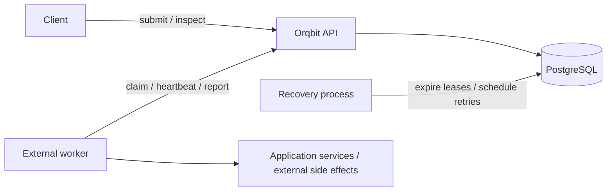
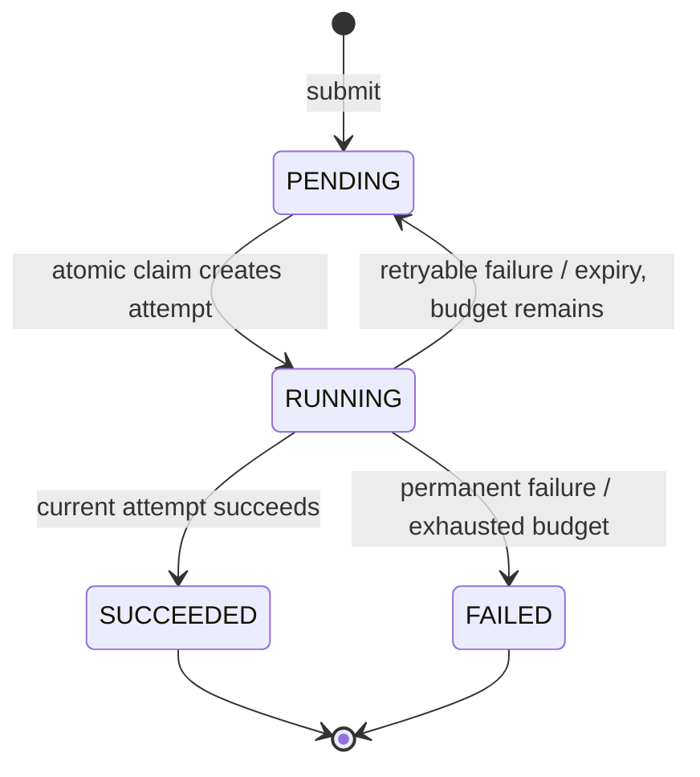

# Proposed architecture and reliability model

Everything in this document is a target design. The [status document](status.md) describes current implementation.

## Components and responsibilities

Use PostgreSQL as the durable source of truth for jobs, attempts, ownership, idempotency, and retry schedules. Start with one API deployment and a separately runnable recovery process; support multiple API/recovery instances through database concurrency control. No broker is required for the initial design. Polling is sufficient initially; a notification mechanism may later reduce polling latency, while durable rows remain authoritative.

Workers execute handlers outside Orqbit. Orqbit coordinates work and records outcomes; it does not restart arbitrary worker processes or run submitted code. A process supervisor/container orchestrator handles restarting worker processes. Here, “restart a failed job” means scheduling another execution attempt.

## Delivery guarantee

Target **at-least-once execution**, conditional on eventual service recovery, available compatible workers, and the configured retry budget. A timeout cannot prove that a worker stopped executing. Lease fencing prevents expired attempts from changing Orqbit state; it cannot undo or automatically fence an external action.

For example, a worker can charge a payment and crash before acknowledging success. Retrying the job can charge again unless the payment API receives a stable operation key. Workers should use a job/business-operation key for deduplicating side effects across attempts, not the attempt ID. If a producer must atomically change its own database and submit a job, consider a transactional outbox in that producer; HTTP submission alone cannot make those two writes atomic.

## Proposed data model

| Entity | Important fields and constraints |
| --- | --- |
| `principals` | Stable authenticated client/service identity; role/capability mapping; tenant scope if multi-tenancy is required |
| `workers` | Unique process-instance ID, authenticated principal ID, permitted types, registration time, last heartbeat, draining state |
| `jobs` | ID, creator principal ID, type, payload/schema version, JSONB parameters, status, `available_at`, retry-policy snapshot, attempt count, current attempt ID, created/updated/finished timestamps, final outcome summary |
| `job_attempts` | ID, job ID, attempt number, worker instance ID, monotonically increasing generation, lease-token verifier, status, start/heartbeat/lease-expiry/deadline/finish timestamps, result or structured error |
| `idempotency_records` | Creator scope, operation, key, canonical request fingerprint, job ID/original response metadata, creation/expiry timestamps; unique `(creator_scope, operation, key)` |

Use database constraints for foreign keys, valid statuses, positive attempt limits, and uniqueness of `(job_id, attempt_number)`. Enforce at most one active attempt per job with a database constraint, such as a partial unique index on running attempts. Define UTC `timestamptz` fields and use database time for lease comparisons.

Keep attempt records after completion; terminal outcomes must not be overwritten by later retries. A currently unassigned job has no current worker; earlier workers remain discoverable through its attempts. Store creator identity from authenticated context, never from a caller-supplied creator field.

Index eligible-job selection by status/type/availability/order, lease expiry for active attempts, creator plus job ID for listings, and job plus attempt number for history. Confirm index choices with real PostgreSQL query plans and representative data.

## State transitions

Use one canonical uppercase job status vocabulary. Scheduled retries can remain `PENDING` with a future `available_at`; a separate retry-wait status is unnecessary initially.

Attempt states should distinguish `RUNNING`, `SUCCEEDED`, `FAILED`, `LEASE_EXPIRED`, and `TIMED_OUT`. Job and attempt transitions must commit together. Reserve cancellation for an explicit future contract; cancelling a lease cannot guarantee that an external action stops.

## Claiming and ownership

1. Authenticate the worker principal and process instance; check its permitted job types.
2. In a short transaction, select one due `PENDING` job matching those types using `FOR UPDATE SKIP LOCKED` and a deterministic order such as `(available_at, id)`.
3. Create the attempt, increment its generation/attempt number, assign the worker, set lease expiry and a hard execution deadline, and mark the job running.
4. Commit before returning the job, attempt ID, token, and lease metadata. Do not hold a database transaction open while the worker executes.

`SKIP LOCKED` is suitable for queue consumers, but does not provide strict global FIFO when rows are locked. See the [PostgreSQL SELECT documentation](https://www.postgresql.org/docs/current/sql-select.html).

Every heartbeat, success, and failure request must prove the authenticated worker instance, job, current attempt, and unexpired lease token. Treat tokens as credentials and avoid exposing them in logs or creator-facing reads. Perform the validity check and update atomically, with row locks or conditional updates; checking in Python before a separate write is insufficient.

After lease expiry/reassignment, reject the earlier attempt's updates even if the job is running again. A generation/token fences Orqbit's state; downstream systems need their own deduplication or fencing when external effects require it.

If a claim response is lost, the job may remain leased until expiry. Document this behavior; optionally add worker-scoped idempotent claim requests later to recover the same assignment safely rather than claiming extra jobs blindly.

## Heartbeats and recovery

Maintain two distinct signals: a worker heartbeat indicates process liveness, while an attempt heartbeat renews ownership of a specific job. A live process may still have a stuck job. A worker heartbeat alone must not extend every job it has ever claimed.

As initial configurable defaults, consider a 10-second attempt heartbeat and a 45-second lease. These are proposals to validate against network latency and workload characteristics. Define a maximum attempt runtime per job type; heartbeat renewal must not extend ownership past that deadline. Workers should stop work cooperatively when lease renewal fails, while acknowledging that external effects may already be in flight.

The recovery loop finds expired leases/deadlines, locks and rechecks each candidate using database time, closes the attempt, and either schedules a retry or marks the job failed. Multiple recovery instances must be safe. A heartbeat racing expiry is resolved by the same transactional ownership rules; it cannot resurrect an expired attempt.

On shutdown, workers stop claiming, continue renewing active work during a bounded grace period, and report outcomes when possible. If they cannot finish, leases eventually expire. API/recovery restarts must not lose committed work.

## Retry policy

Count every claimed attempt, including crashes and timeouts. Store a policy snapshot per job: `max_attempts` includes the first attempt; retryable error categories, initial delay, maximum delay, and optional overall job deadline are explicit.

Use capped exponential backoff with jitter and persist the next `available_at`. Permanent validation/business errors should not retry automatically. A retryable failure closes the current attempt and returns the job to pending in one transaction. Exhausted attempts leave a terminal `FAILED` job with inspectable history, serving as the initial dead-letter view.

Provide operator replay later with authorization and audit. Prefer a new linked job and a new submission key so the original failed history and retry budget remain intact.

## Idempotency contracts

For submission, require an `Idempotency-Key` in the target API. Scope it to the authenticated creator/tenant and operation. Fingerprint a canonical representation of all semantic request fields, including type and payload version. Insert the key record and job in the same transaction, protected by database uniqueness.

- Same key and same request: return the original job identity and documented creation response, even if that job has since completed.
- Same key and different request: return `409 Conflict`.
- Concurrent matching requests: resolve to one committed job.
- Lost response after commit: a retry retrieves that same job.

Declare the retention/replay window. Retain a deduplication tombstone if job details are purged while the key is still valid. After the documented window expires, key reuse may create a new job. Keys do not replace authentication, and should not include secrets.

For success/failure reports, accept an exact replay of a previously accepted report for the same authenticated attempt without creating another transition. Reject contradictory outcomes or stale attempts with a conflict. An exact replay may be acknowledged after the lease has ended because it records no new state; a new outcome still requires a valid lease. Heartbeat retries must not resurrect expired ownership.

Submission deduplication, acknowledgement deduplication, and idempotent external execution are separate requirements; all three matter.
