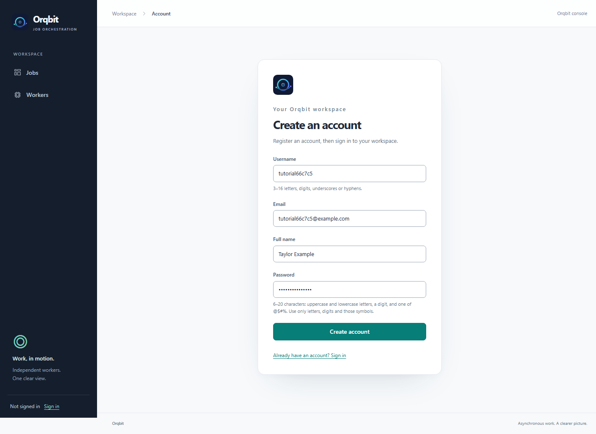

# 2. Create your account

[← Install and open](01-install-and-open.md) · [Tutorial home](README.md) · [Next: Register a worker →](03-register-a-worker.md)

**Goal:** sign in to your own workspace.

## Register

1. Open [http://localhost:8080](http://localhost:8080), or the web address provided by your administrator.
2. Choose **Create an account** below the sign-in form.
3. Complete the fields:

| Field | What to enter |
| --- | --- |
| Username | A unique name with 3–16 letters, digits, underscores, or hyphens, such as `taylor-demo`. Use Latin letters. |
| Email | Your email address. It must not already be registered. |
| Full name | The name you want displayed in your workspace. |
| Password | Your own password matching the rules below. |

Passwords must have **6–20 characters**, including an uppercase letter, a lowercase letter, a digit, and one of `@`, `$`, `#`, `%`. Only Latin letters, digits, and those four symbols are accepted. Choose a password you do not use elsewhere.

4. Select **Create account**.
5. When Orqbit returns you to sign-in, enter your **username** and password, then select **Sign in**. Use your username rather than your email address.

You should arrive at **Jobs**. An empty queue is normal: you have not submitted anything yet.

## Keep using the same account

Register your worker and submit the tutorial jobs while signed in to this account. That lets you use the default **Private** access settings without additional sharing setup.

Refreshing or reopening the page keeps you signed in until your session expires or you sign out. With the example configuration, sessions last 30 minutes. If asked to sign in again, use your existing account; your jobs and workers are still saved.

If your username or email already exists, sign in to that account or choose unused details. There is currently no password-reset screen, so keep your password somewhere safe.

**Ready:** the Jobs page is visible and your name appears in the sidebar.

[Continue to 3. Register a worker →](03-register-a-worker.md)
