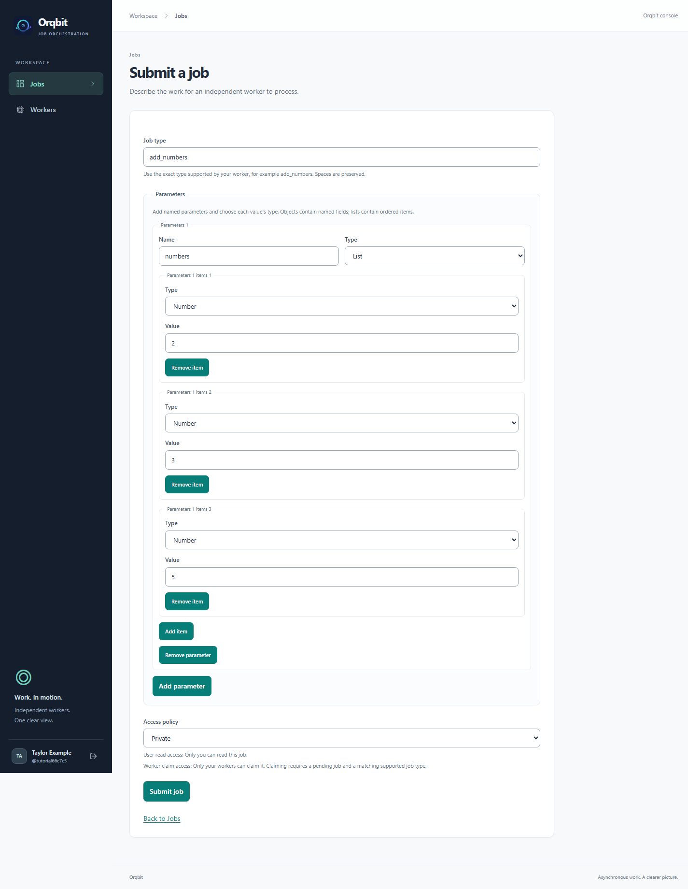

# 5. Submit your first job

[← Start your worker](04-start-your-worker.md) · [Tutorial home](README.md) · [Next: Progress and results →](06-progress-and-results.md)

**Goal:** ask your worker to add `2`, `3`, and `5`.

Keep the worker terminal running and return to the web interface, signed in with the same account that registered it.

## Describe the work

1. Select **Jobs** in the sidebar, then **Submit a job**.
2. Set **Job type** to `add_numbers`.
3. Under **Parameters**, select **Add parameter**.
4. Set its **Name** to `numbers` and its **Type** to **List**.
5. Inside that list, select **Add item**. Change the item's **Type** to **Number** and enter `2` as its **Value**.
6. Add two more items in the same way, with **Number** values `3` and `5`.
7. Leave **Access policy** set to **Private**.

Your form should look like this:



Choose **Number** for each list item. The default **Text** type would send text instead of numbers, and the addition worker would reject it. Enter one number per item; do not paste `[2,3,5]` into a single text value.

For reference, the parameters you have built are:

```json
{"numbers": [2, 3, 5]}
```

You do not need to type JSON yourself: the form builds it from your entries.

## Submit

Select **Submit job**. Orqbit saves it and opens **Job details**. Note the job number, or bookmark this page so you can return to it.

The job first becomes **Pending**, then **Running** when a suitable worker takes it. Addition is quick, so you may see **Succeeded** immediately. This is expected; you do not need to catch every intermediate state.

If no matching worker is running, the job stays Pending until one becomes available. Registering a worker alone does not execute anything.

## If the submission response is interrupted

Keep the form open and use **Retry submission** if offered. That button resends the same submission safely, allowing Orqbit to return the already-created job if it received the first request.

**Start a new submission** is for a separate or revised request; it can create another job. If you left the page after an uncertain response, check **Jobs → All statuses** before submitting the same work again.

**Ready:** you have a job number and its Job details page is open.

[Continue to 6. Follow progress and read the result →](06-progress-and-results.md)
