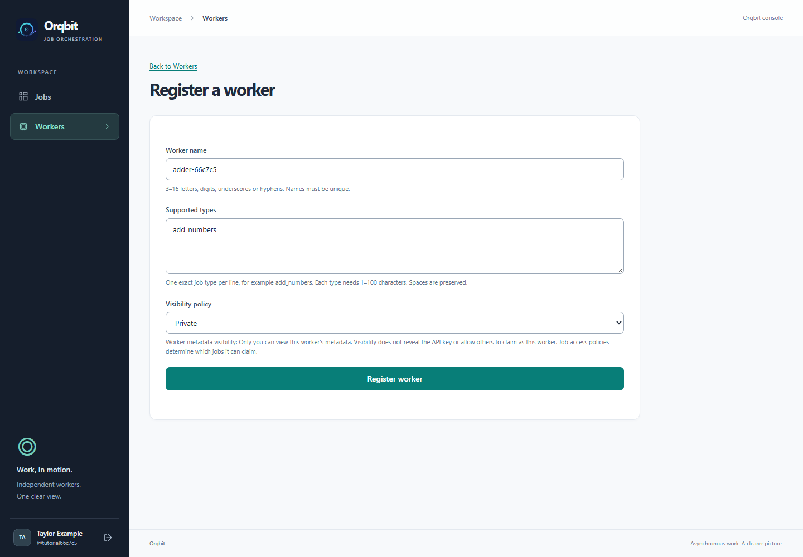

# 3. Register a worker

[← Create your account](02-create-your-account.md) · [Tutorial home](README.md) · [Next: Start your worker →](04-start-your-worker.md)

**Goal:** register the supplied addition worker and save its API key.

## Fill in the registration form

1. Select **Workers** in the sidebar.
2. Select **Register a worker**.
3. Enter these values:

| Field | Value for this walkthrough |
| --- | --- |
| Worker name | `my-adder`, or another unused name. |
| Supported types | `add_numbers` |
| Visibility policy | **Private** |

Worker names must be unique and contain 3–16 Latin letters, digits, underscores, or hyphens.

The **worker name** is a label you choose. The **supported type** tells Orqbit what that program can do. For this example, enter `add_numbers` exactly: use an underscore, lowercase letters, and no surrounding spaces or extra blank lines.

The screenshot uses a different unique worker name; you can keep `my-adder`.

4. Select **Register worker**.

## Save the API key before leaving

The confirmation page displays the worker's **API key**. Select **Copy API key** and save it securely, for example in your password manager. You will paste it into the worker's configuration in the next step.

**The key is shown only once.** Leaving or reloading this page means you cannot retrieve it again. Keep it private: it allows a program to act as this worker. Do not put it in a job's parameters, screenshots, or a shared repository.

After saving it, choose **I've saved the key — view worker**.

## What you have just created

You have given a worker permission to connect to Orqbit. You still need to start the actual program on your computer.

An **Active** credential/registration status means its credentials are enabled. It does not tell you whether the worker program is running. **Private** visibility controls who can see its registration details; which jobs it can process is controlled by each job's access policy and type.

If you lose the key, open **Workers**, select your worker, choose **Reissue API key**, and confirm with **Confirm reissue**. Save the replacement key, update the worker's `.env`, and restart the program. The old key stops working immediately. Reissuing preserves the worker's identity and existing attempts; it does not reactivate an inactive registration. The original key cannot be retrieved.

For an API-based alternative, use your user bearer token with `POST /workers/{worker_id}/api-key`; see [worker management](../../docs/api.md#worker-management).

**Ready:** you can view your worker's details and have saved its API key.

[Continue to 4. Start your worker →](04-start-your-worker.md)
