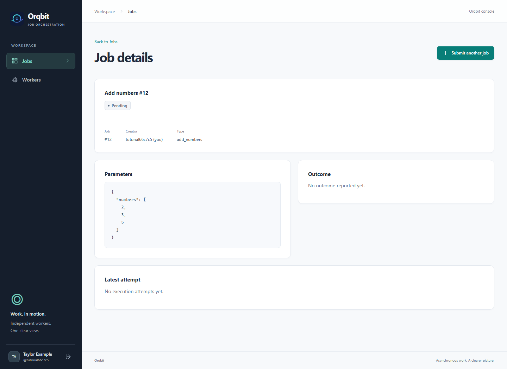
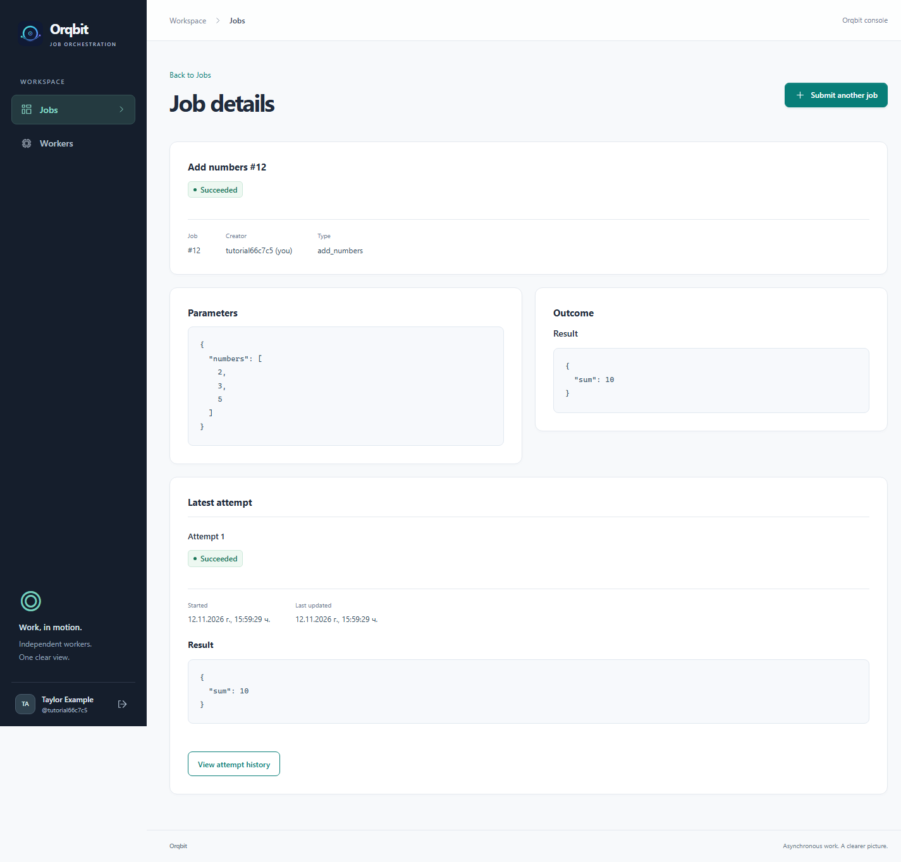
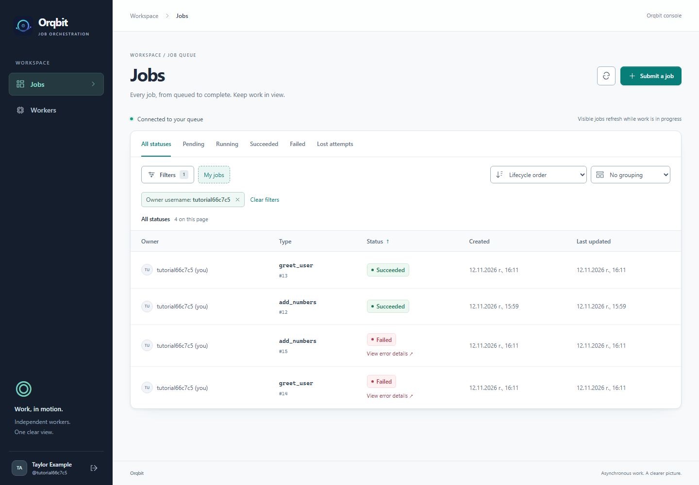
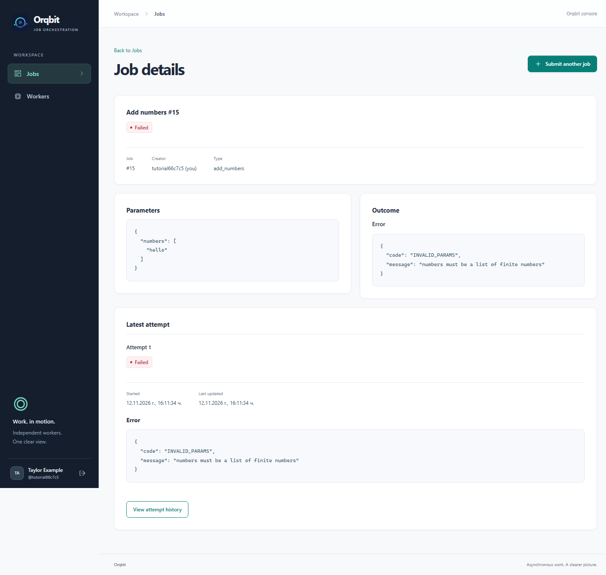
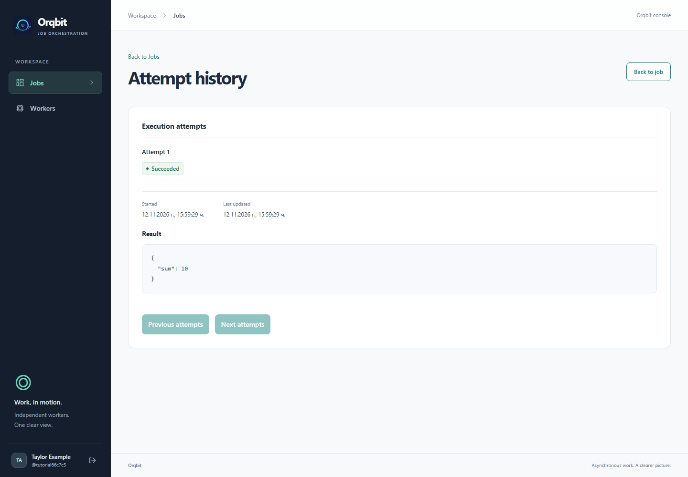

# 6. Follow progress and read the result

[← Submit a job](05-submit-your-first-job.md) · [Tutorial home](README.md) · [Next: Create your own worker →](07-create-your-own-worker.md)

**Goal:** find your job, understand its status, and read its saved result.

## Watch a job

The **Job details** page shows its current status, creator, type, parameters, and outcome. While the page is visible and the job is Pending or Running, it checks for updates about every three seconds. Updates pause in a background tab and stop when the job finishes.

| Status | What it means | What to do |
| --- | --- | --- |
| **Pending** | Saved and waiting for an eligible worker, or waiting for a retry if retries were enabled. | Check that the right worker is running. |
| **Running** | A worker has taken this job for an execution attempt. | Wait for its outcome. There is currently no percentage progress indicator. |
| **Succeeded** | The worker reported success and Orqbit saved the result. | Read **Outcome → Result**. |
| **Failed** | The worker reported an error, or recovery could not schedule another attempt after one was lost. | Read **Outcome → Error** and the attempt history. |

This is how a job looks before a worker has picked it up:



For something slow enough to watch, try the `delay_with_heartbeat` example from [step 4](04-start-your-worker.md#try-a-different-supplied-worker-later). After registering and starting it, submit a `delay_with_heartbeat` job with no parameters. It normally stays Running for about 150 seconds, then succeeds. A heartbeat is simply the worker telling Orqbit that it is still working.

## Read your answer

For the addition job, look for **Succeeded**, then find **Outcome → Result**:

```json
{
  "sum": 10
}
```



The **Parameters** panel contains what you asked for; **Result** contains what the worker returned. You can select and copy the result text. It is saved on the server, so you can close the page and return later. Keeping the worker running is unnecessary for reading a finished result.

## Find a job again

1. Select **Jobs**.
2. Choose **All statuses**, or **Succeeded** if you are looking for your finished addition job. The page opens on **Pending** by default, so a finished job can disappear from that view.
3. To show only your submissions, open **Filters**, enter your exact username in **Owner username**, and select **Apply filters**. Without that filter, the list includes all jobs you can access.
4. Select the job's type/name in its row to reopen its details.



When the list grows, open **Filters** and enter the exact **Job type**, such as `add_numbers`, then select **Apply filters**. You can also filter by owner or creation dates, sort with the toolbar or column headings, and use **Next jobs** / **Previous jobs** when available. The refresh icon near **Submit a job** reloads the list.

Grouping and “on this page” counts describe the current page, not every saved job.

## Read an error

To try an intentional failure, submit another `add_numbers` job. Create the `numbers` List again, but make its only item **Text** with value `hello`. Keep the addition worker running.

The job should become **Failed** and show this error:

```json
{
  "code": "INVALID_PARAMS",
  "message": "numbers must be a list of finite numbers"
}
```



The server accepted a job, but the worker could not use its input. Correct the values and submit a **new job**. Finished jobs cannot currently be edited or restarted through the interface. A worker-reported failure is not automatically retried.

## Inspect execution attempts when needed

An **attempt** is one worker execution of a job. The details page shows **Latest attempt**. Select **View attempt history** for earlier executions and their outcomes, newest first.



An attempt marked **Lost** means its execution time window expired without an accepted outcome. For example, the worker may have stopped or lost its connection. **Lost attempts** on the Jobs page finds jobs with such a history; a job may since have retried and succeeded.

With the tutorial's default settings, jobs get one attempt. The recovery process marks an abandoned attempt Lost and eventually marks the job Failed. If an administrator enabled retries, it can instead return to Pending for another attempt after a delay. Restarting a worker does not by itself restart a failed job.

**Ready:** your first job has Succeeded and its Result contains `"sum": 10`.

Next, [create your own worker](07-create-your-own-worker.md), or skip to [stopping, restarting, and troubleshooting](08-everyday-use-and-troubleshooting.md).
